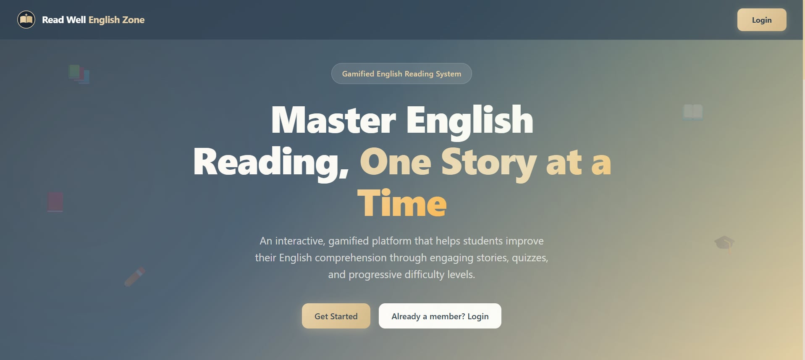
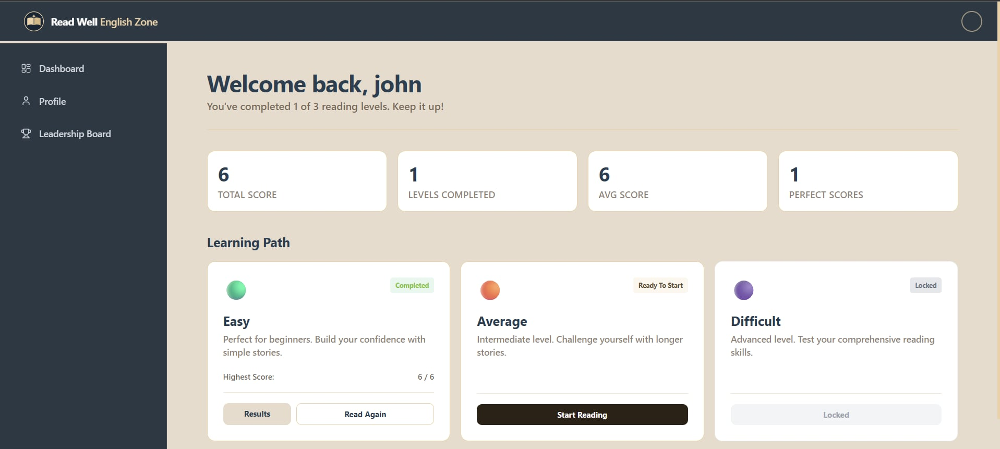
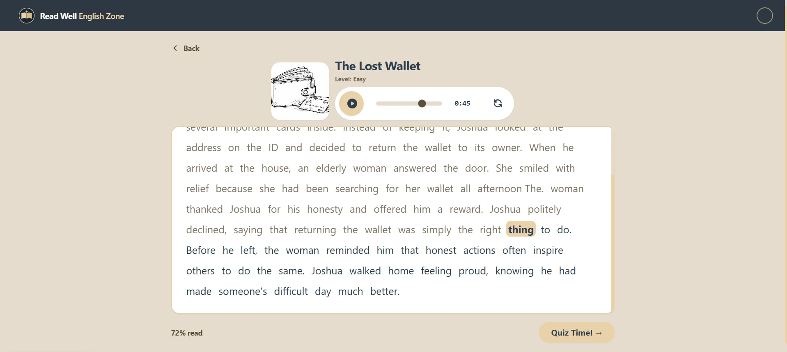
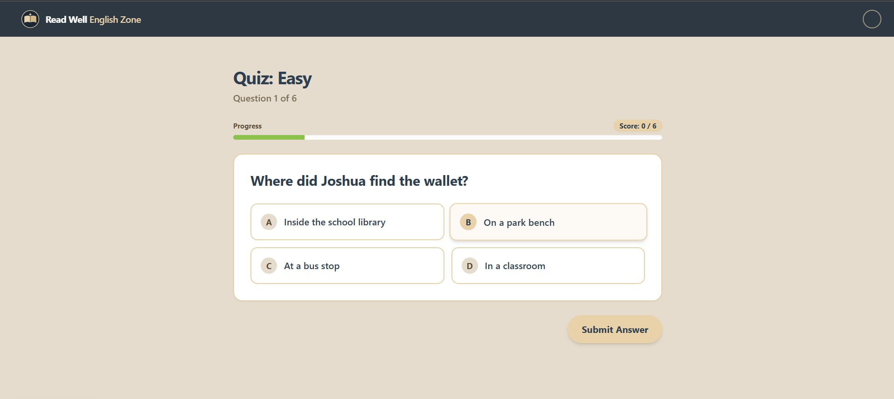
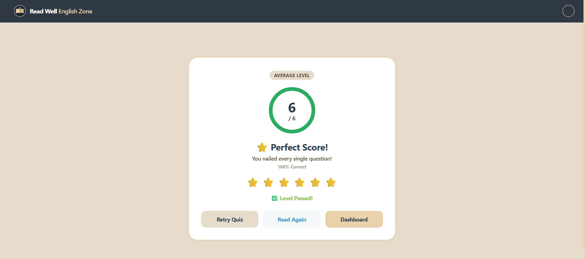
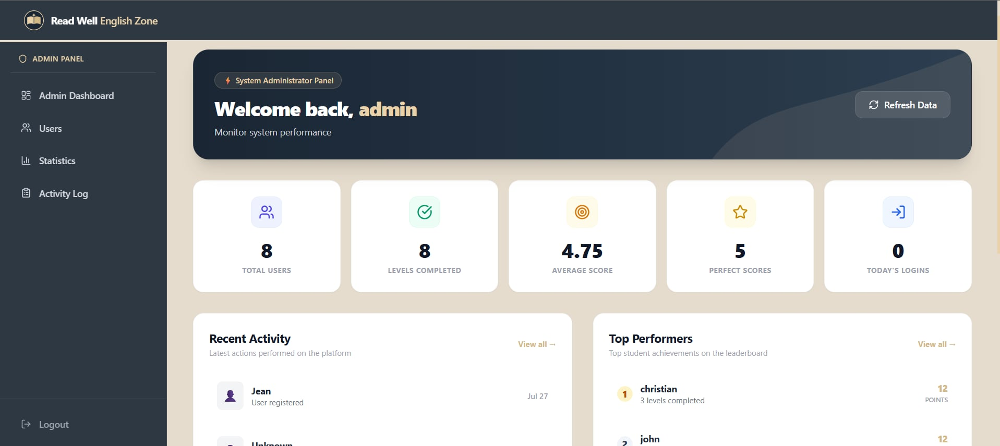

#  Read Well English Zone

**Read Well English Zone** is a modern, gamified educational reading system designed to help students improve their English comprehension through engaging stories, interactive quizzes, and progressive difficulty levels. 

Built with React, Vite, and Tailwind CSS, the platform offers a beautiful, responsive, and highly interactive user experience.

---

##  Live Demo

[Click here for live demo.](https://educ-reading-system.vercel.app/)

---

##  Screenshots

| Landing Page | Dashboard | Story Reader |
|--------------|-----------|--------------|
|  |  |  |

| Quiz | Results | Admin Dashboard |
|------|---------|-----------------|
|  |  |  |

---

##  Features

###  For Students
- **Gamified Learning**: Earn points and track progress as you read stories and take quizzes.
- **Progressive Difficulty**: Start at the *Easy* level and unlock *Average* and *Difficult* levels as your skills improve.
- **Interactive Quizzes**: Test your comprehension after each story with multiple-choice questions.
- **Visual Progression**: Watch your student avatar evolve (Pre-School ➔ High School ➔ College) as you level up!
- **Personalized Dashboard**: View your total score, average score, perfect scores, and completed levels.
- **Leaderboard**: Compete with fellow learners and climb the ranks.
- **Audio Feedback**: Enjoy satisfying sound effects for correct/wrong answers and passing/failing levels.

###  For Administrators
- **Admin Dashboard**: A dedicated interface for managing the platform.
- **User Management**: View and manage registered students.
- **Statistics & Activity Logs**: Monitor overall platform usage, user progress, and engagement metrics.

---

##  Tech Stack

### Frontend
| Technology | Description |
|------------|-------------|
|  | UI Library |
|  | Build Tool |
|  | Styling |
|  | Animations |
|  | Routing |

### Backend
| Technology | Description |
|------------|-------------|
|  | Database & Authentication |
|  | Database |

### Tools & Libraries
| Technology | Description |
|------------|-------------|
|  | State Management |
|  | Form Handling |
|  | Validation |
|  | Notifications |

### Hosting
| Technology | Description |
|------------|-------------|
|  | Hosting & Deployment |

---

##  Getting Started

### Prerequisites
- Node.js (v16.0.0 or higher)
- npm (v8.0.0 or higher)
- A Supabase project with the required database schema (profiles, user_progress, quiz_questions, etc.)

### Installation

1. **Clone the repository**:
   ```bash
   git clone https://github.com/eljohnluar/readwell-english-zone.git
   cd readwell-english-zone
Install dependencies:

bash
npm install
Set up Environment Variables:
Create a .env file in the root directory based on .env.example and add your Supabase credentials:

env
VITE_SUPABASE_URL=your_supabase_project_url
VITE_SUPABASE_ANON_KEY=your_supabase_anon_key
Start the development server:

bash
npm run dev
Open your browser and visit http://localhost:5173.

### Project Structure

src/

├── assets/         # Images, audio, and static assets

├── components/     # React components

│   ├── admin/      # Admin dashboard and management views

│   ├── auth/       # Login, Register, Password Reset

│   ├── common/     # Reusable UI (Header, Loader, ProtectedRoute)

│   ├── landing/    # Guest landing page

│   └── user/       # Student dashboard, quiz, story reader, results

├── config/         # Configuration files (levels definition)

├── context/        # React Context (AuthContext, ProgressContext)

├── hooks/          # Custom React hooks

├── lib/            # Library instances (Supabase client)

├── services/       # API and external service integrations

├── styles/         # Additional global styles

├── App.jsx         # Main application router

├── index.css       # Global CSS and Tailwind directives

└── main.jsx        # Application entry point

### UI/UX Design Philosophy
The application is designed with Premium Aesthetics in mind to keep students engaged:

Color Palette: A curated mix of Gold (#E9D2A9), Cream (#E5DCCD), Dark Blue (#2C3E50), and status colors (Easy Green, Average Orange, Difficult Purple).

Micro-interactions: Hover effects, smooth page transitions, and confetti celebrations on perfect scores.

Loading Experiences: A custom fullscreen animation showing a student walking and evolving through life stages while content loads.

### License
This project is licensed under the MIT License.
